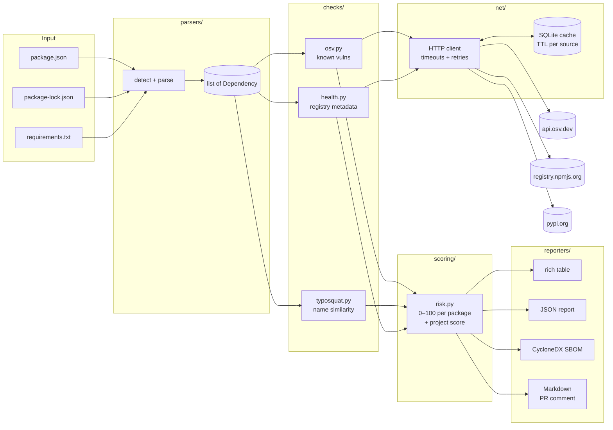

# ChainSentry — Implementation Plan

> Dependency & supply-chain risk scanner (CLI + GitHub Action).
> This document is the roadmap for the whole project. Every phase lists **what**
> gets built, **why** it is built that way, and **what to study** alongside it.
> Status: **approved** — built one phase at a time.

---

## 0. Ground rules for this project

| Rule | How it is applied |
|---|---|
| No Docker | Everything runs in a plain Python virtualenv. The GitHub Action is a **composite** action (runs on the runner's Python), not a Docker action. |
| Commit every file change | Each created or modified file gets its own commit, using [Conventional Commits](https://www.conventionalcommits.org/) (`feat:`, `fix:`, `test:`, `docs:`, `chore:`, `ci:`). Small, atomic history is easy to review and easy to explain. |
| Branch per phase | Work for phase N happens on `phase-N-<name>`; when the phase is approved it is merged into `main` with `--no-ff` so the history shows each phase as a unit. |
| Comments everywhere | See §7 "Commenting standard". Every module starts with a docstring explaining *why it exists and the design choices made*. |
| Phase-by-phase | Build only the current phase. After each phase: what was built, why, 2–3 interview questions, how to test it yourself, and concepts to study. Then wait for your OK. |
| Tests never hit the network | Unit tests mock HTTP (with `respx`). Optional live tests are marked `@pytest.mark.network` and skipped by default. |

---

## 1. Architecture

### 1.1 Data flow



### 1.2 Layering rule (why the folders exist)

`cli → scanner → (parsers, checks, scoring, reporters) → models / net`

* **models.py** is the shared vocabulary (dataclasses). Every layer speaks it; nothing else is shared.
* **parsers/** only read files → `Dependency` objects. No network.
* **checks/** take `Dependency` objects → `Finding` objects. They never print anything.
* **scoring/** is pure math on findings. No I/O at all → trivially unit-testable.
* **reporters/** turn a `ScanResult` into text/files. They never compute risk.
* **scanner.py** is the only place that wires everything together (orchestrator).

This separation means each piece can be tested in isolation and swapped
(e.g. adding a `Cargo.lock` parser touches only `parsers/`). In interviews
this is "separation of concerns" + "dependency direction points inward".

---

## 2. Folder structure

```
chainsentry/
├── PLAN.md                     # this file
├── README.md                   # problem, architecture, install, usage, sample output, limitations
├── pyproject.toml              # packaging, deps, console script, pytest/ruff config
├── .gitignore
├── LICENSE                     # MIT
├── action.yml                  # composite GitHub Action (phase 6)
├── .github/workflows/
│   ├── ci.yml                  # run tests + lint on every push/PR
│   └── chainsentry.yml            # dogfood: run ChainSentry on this repo's PRs
├── docs/
│   ├── SCORING.md              # the scoring formula, explained with examples
│   ├── SECURITY_CONCEPTS.md    # study notes: CVE, GHSA, CVSS, SBOM, typosquatting...
│   └── sample-output/          # real outputs used by the README
├── src/chainsentry/
│   ├── __init__.py             # version string
│   ├── __main__.py             # enables `python -m chainsentry`
│   ├── cli.py                  # argparse CLI, exit codes
│   ├── config.py               # defaults: TTLs, thresholds, weights, paths
│   ├── models.py               # Dependency, Vulnerability, Finding, PackageReport, ScanResult
│   ├── scanner.py              # orchestrator
│   ├── net/
│   │   ├── client.py           # httpx client: timeouts, retries, backoff, User-Agent
│   │   └── cache.py            # SQLite TTL cache
│   ├── parsers/
│   │   ├── base.py             # Parser protocol, registry, auto-detection
│   │   ├── npm_package_json.py
│   │   ├── npm_lockfile.py     # lockfileVersion 1, 2 and 3
│   │   ├── pip_requirements.py
│   │   └── npm_semver.py       # small npm range matcher (^, ~, x, ||, >=…)
│   ├── checks/
│   │   ├── base.py             # Check protocol
│   │   ├── osv.py              # OSV batch query + vuln detail fetch
│   │   ├── cvss.py             # CVSS v3.x base-score calculator
│   │   ├── typosquat.py
│   │   ├── health.py
│   │   └── data/
│   │       ├── top_npm.txt     # ~5,000 popular npm names (snapshot, dated)
│   │       ├── top_pypi.txt    # ~5,000 popular PyPI names (snapshot, dated)
│   │       └── allowlist.txt   # known false positives
│   ├── scoring/
│   │   └── risk.py
│   └── reporters/
│       ├── table.py            # rich terminal output
│       ├── json_report.py
│       ├── cyclonedx.py        # CycloneDX 1.5 JSON SBOM
│       └── markdown.py         # PR comment / job summary
├── scripts/
│   ├── update_popular_lists.py # regenerates checks/data/top_*.txt
│   └── batch_scan.py           # phase 7: scan many public repos
├── dashboard/                  # phase 7: plain HTML + JS, no build step
│   └── index.html
└── tests/
    ├── conftest.py
    ├── fixtures/               # sample manifests + recorded API responses
    ├── test_parser_package_json.py
    ├── test_parser_lockfile.py
    ├── test_parser_requirements.py
    ├── test_npm_semver.py
    ├── test_cache.py
    ├── test_osv.py
    ├── test_cvss.py
    ├── test_typosquat.py
    ├── test_health.py
    ├── test_scoring.py
    ├── test_reporters.py
    └── test_cli.py
```

**Why `src/` layout?** With `src/`, tests import the *installed* package, not
whatever happens to be in the current directory. This catches packaging bugs
(missing data files, wrong imports) that a flat layout hides.

---

## 3. Tech choices (and why)

| Need | Choice | Reason |
|---|---|---|
| Python | 3.11+ (you have 3.12.6) | `tomllib`, `StrEnum`, faster runtime, modern typing (`X \| None`). |
| HTTP | **httpx** (sync) | Timeouts are mandatory by design, clean API, and `respx` makes mocking trivial. Concurrency via a small thread pool for per-package registry calls. |
| Terminal | **rich** | Colored tables, panels, progress bars. |
| Version logic | **packaging** | The official PyPA implementation of PEP 440 versions and PEP 508 requirements — do not re-invent Python version parsing. |
| npm ranges | own `npm_semver.py` | Small, well-tested subset (`^ ~ x * >= < \|\|` and hyphen ranges). Educational and avoids a dependency; unsupported syntax is reported as "unresolved", never guessed. |
| CLI | **argparse** (stdlib) | Zero dependencies, universally understood. |
| Cache | **sqlite3** (stdlib) | One file, atomic writes, indexed lookups, safe with threads. Better than thousands of JSON files. |
| Edit distance | own Damerau-Levenshtein | ~25 lines, you can explain it line by line on a whiteboard. |
| SBOM | hand-written CycloneDX JSON | The format is plain JSON; writing it ourselves shows you understand the spec. |
| Tests | **pytest**, **pytest-cov**, **respx** | Mocked network, coverage report. |
| Lint | **ruff** | Fast lint + formatting in one tool. |

Runtime deps: `httpx`, `rich`, `packaging`. Dev deps: `pytest`, `pytest-cov`, `respx`, `ruff`.

---

## 4. Core data model (`models.py`)

```python
class Ecosystem(StrEnum):           # values match OSV's ecosystem names exactly
    NPM = "npm"
    PYPI = "PyPI"

@dataclass(frozen=True)
class Dependency:
    name: str                       # normalised (PEP 503 for PyPI, lowercase for npm)
    version: str | None             # exact version if known, else None
    spec: str | None                # original constraint, e.g. "^4.17.0" or ">=2.0"
    ecosystem: Ecosystem
    source_file: str
    direct: bool                    # declared by the project vs pulled in transitively
    dev: bool                       # devDependency / dev requirement
    resolved_url: str | None = None # lockfile "resolved" (detects non-registry sources)
    # property: purl -> "pkg:npm/%40scope/name@1.2.3" / "pkg:pypi/requests@2.31.0"

@dataclass
class Vulnerability:
    id: str                         # e.g. GHSA-xxxx or PYSEC-xxxx
    aliases: list[str]              # e.g. ["CVE-2024-1234"]
    summary: str
    cvss_score: float | None
    cvss_vector: str | None
    severity: Severity              # CRITICAL / HIGH / MEDIUM / LOW / UNKNOWN
    affected_ranges: list[str]      # human readable: ">=1.0.0, <1.2.5"
    fixed_versions: list[str]
    references: list[str]

@dataclass
class Finding:                      # one non-vulnerability signal
    check: str                      # "typosquat" | "health" | "parser"
    code: str                       # e.g. "INSTALL_SCRIPT", "TYPOSQUAT", "NOT_IN_REGISTRY"
    severity: Severity
    message: str
    details: dict

@dataclass
class PackageReport:  dependency, vulnerabilities, findings, score, band
@dataclass
class ScanResult:     packages, project_score, project_band, files, errors, tool_version, timestamp
```

---

## 5. Phases

Each phase ends with: summary · design rationale · interview questions · "test it yourself" commands · concepts to study. Then **stop and wait for OK**.

### Phase 0 — Skeleton (small, done together with Phase 1)
* `pyproject.toml` (console script `chainsentry = chainsentry.cli:main`), `.gitignore`, `LICENSE`, `src/chainsentry/__init__.py`, `__main__.py`, `models.py`, `config.py`, a stub `cli.py` that prints the version.
* `.github/workflows/ci.yml` runs ruff + pytest on Python 3.11/3.12, Ubuntu + Windows.
* **Done when:** `pip install -e .[dev]` works, `chainsentry --version` prints, `pytest` runs (0 tests is fine).

### Phase 1 — Parsers
**requirements.txt** (`pip_requirements.py`)
* Parse with `packaging.requirements.Requirement` (PEP 508) — handles extras `pkg[security]`, environment markers `; python_version < "3.12"`.
* Handle: comments, blank lines, `\` line continuations, `-r other.txt` includes (with cycle detection + must stay inside the project dir), `-c` constraints, `--hash=` options (stripped; noted as "hash-pinned" = good), `-e`/VCS/URL requirements (skipped with a warning finding — cannot be looked up in OSV).
* Version: only `==X` (no wildcard) or `===X` is an **exact** pin. Anything else → `version=None` and a `UNPINNED` finding. Phase 2 can optionally resolve ranges to the newest matching release from PyPI (`--resolve`), clearly labelled as "resolved, not locked".
* Normalise names per **PEP 503** (`Flask_Login` → `flask-login`), because OSV/PyPI compare normalised names.

**package.json** (`npm_package_json.py`)
* Read `dependencies`, `devDependencies`, `optionalDependencies`, `peerDependencies` (peer reported, not scanned by default).
* Exact versions (`"1.2.3"`) are used directly; ranges stay unresolved unless `--resolve`. Non-registry specs (`git+…`, `file:`, `http…`, `github:user/repo`, `npm:alias@x`) produce a finding — they bypass registry integrity guarantees.

**package-lock.json** (`npm_lockfile.py`)
* Support `lockfileVersion` 1 (nested `dependencies` tree), 2 and 3 (flat `packages` map keyed by `node_modules/a/node_modules/b`).
* Extract name from the *last* `node_modules/` segment (handles scoped `@scope/name`), skip the root `""` entry and `link: true` workspace entries, keep `dev`/`optional` flags, keep duplicates (same package at two versions = two dependencies).
* Mark `direct=True` for names that appear in the root package's dependency lists.
* Flag `resolved` URLs not on `registry.npmjs.org` and entries missing `integrity`.

**Auto-detection** (`base.py`): given a directory, find supported files (non-recursive by default, `--recursive` skips `node_modules/`, `.venv/`, `.git/`). If both `package.json` and `package-lock.json` exist, the lockfile wins for versions and `package.json` supplies `direct`.

**Safety:** files are only *read and parsed* (`json.loads`, line parsing) — nothing is executed, nothing is installed. Files over 50 MB are refused.

**Tests:** fixture files for each lockfile version, tricky requirements lines, scoped packages, aliases, broken JSON (clear error, no traceback).

📚 Study: semantic versioning & npm ranges, PEP 440/503/508, why lockfiles matter for reproducibility and security, direct vs transitive dependencies.

### Phase 2 — OSV vulnerability lookup + HTTP/cache layer
**net/client.py**: one shared `httpx.Client` with connect/read timeouts, a descriptive `User-Agent`, retries with exponential backoff on 429/5xx/connection errors (respecting `Retry-After`), and safe URL-encoding of package names (a name like `../../x` must never change the request path).

**net/cache.py**: SQLite table `(key TEXT PRIMARY KEY, value BLOB, expires_at REAL)`; key = SHA-256 of method + URL + body. TTLs: OSV query results 6 h, vulnerability details 24 h, registry metadata 24 h. Location: `%LOCALAPPDATA%\chainsentry` on Windows / `~/.cache/chainsentry` elsewhere, overridable with `CHAINSENTRY_CACHE_DIR`. Flags: `--no-cache`, `chainsentry cache clear`.

**checks/osv.py**
1. `POST https://api.osv.dev/v1/querybatch` with up to 1,000 `{package:{name, ecosystem}, version}` queries per request (chunked).
2. The batch endpoint returns **only vuln IDs** — so for each unique ID, `GET /v1/vulns/{id}` for the details (cached, de-duplicated, thread pool). Follow `next_page_token` when present.
3. From each record extract: aliases (CVE IDs), summary, affected ranges for *this* package (`affected[].ranges[].events` → `introduced` / `fixed` / `last_affected`), fixed versions, references.
4. Severity: if a `CVSS_V3` vector is present, compute the base score with our own **CVSS v3.1 calculator** (`cvss.py`, tested against NVD examples). If only CVSS v4 or none, fall back to `database_specific.severity` (GHSA gives CRITICAL/HIGH/MODERATE/LOW). Otherwise `UNKNOWN`.
* Dependencies without an exact version are not queried (OSV needs a version) and are listed as "not checked".

**Privacy note (good interview point):** querying a public API leaks your dependency names. For private/internal packages that's sensitive, so ChainSentry supports `--exclude <glob>` and `--offline` (typosquat check only).

📚 Study: CVE vs GHSA vs PYSEC IDs and aliasing, the OSV schema, CVSS v3.1 metrics (AV/AC/PR/UI/S/C/I/A) and why base score ≠ real risk, CVSS v4, EPSS & CISA KEV (for "limitations / future work"), rate limiting and caching strategies.

### Phase 3 — Typosquatting detection
**Data:** `scripts/update_popular_lists.py` builds dated snapshots of the top ~5,000 names per ecosystem (PyPI from the public "top PyPI packages" download dataset; npm from a public high-impact/most-downloaded list — exact sources verified and documented at the start of the phase). Snapshots are committed so the check works offline.

**Algorithm** for each dependency name *n*:
1. Normalise (PEP 503 for PyPI, lowercase, Unicode NFKC + a small confusables map such as Cyrillic `а`→`a`).
2. If *n* is itself in the popular list or the allowlist → not suspicious, stop.
3. Compare against popular names with a cheap length pre-filter (|len a − len b| ≤ 2), then targeted detectors, each producing a labelled reason:
   * **separator confusion** — `python-dateutil` vs `python_dateutil` vs `pythondateutil`
   * **omission / insertion / repeated letter** — `requets`, `requestss`
   * **transposition** — `reqeusts` (Damerau-Levenshtein handles swaps as one edit)
   * **homoglyph / visual** — `rn`↔`m`, `l`↔`1`↔`I`, `0`↔`o`, non-ASCII look-alikes
   * **affix/combosquat** — popular name plus `-js`, `py-`, `python-`, `node-`, `-dev`
   * **scope squatting (npm)** — `@typess/node` vs `@types/node`; unscoped copy of a scoped name
4. Edit-distance threshold scales with length (≤1 for names ≤ 8 chars, ≤ 2 for longer); names shorter than 4 chars are only flagged by homoglyph/separator rules (otherwise `six`/`sip` style false positives explode).
5. Confidence = HIGH when the target is in the top 1,000 and the technique is a classic one (homoglyph, transposition, separator); MEDIUM otherwise.

**Tests:** table-driven — known real attack names (e.g. `crossenv`, `python3-dateutil`, `jeIlyfish`) must be flagged; legitimate pairs (e.g. `request`/`requests`… handled via allowlist, `pytest`/`pytest-cov`) must not.

📚 Study: real incidents — `crossenv` (npm, 2017), `jeIlyfish`/`python3-dateutil` (PyPI, 2019), `ua-parser-js` and `coa`/`rc` account takeovers (2021), `event-stream` (2018), the 2021 **dependency confusion** research (Alex Birsan), the `xz-utils` backdoor (2024), and the 2025 npm "Shai-Hulud" worm. Levenshtein vs Damerau-Levenshtein, precision vs recall trade-off.

### Phase 4 — Package health checks
**npm** — `GET https://registry.npmjs.org/<name>` (scoped names encoded as `@scope%2Fname`). Use `time.created`, `time[<version>]`, `time.modified`, `maintainers`, `versions[v].scripts` and `versions[v].deprecated`, `repository`.
**PyPI** — `GET https://pypi.org/pypi/<name>/json`. Use `releases[*][*].upload_time_iso_8601`, `yanked`, `info.project_urls`. *PyPI's JSON API does not expose the maintainer list* — reported honestly as "unknown", not guessed.

| Code | Rule | Why it matters |
|---|---|---|
| `NOT_IN_REGISTRY` | 404 from public registry | Possible internal name → **dependency confusion** target |
| `INSTALL_SCRIPT` | npm `preinstall`/`install`/`postinstall` | Arbitrary code runs on `npm install` — the #1 malware vector |
| `NEW_PACKAGE` | first published < 30 days ago | Most malicious packages are removed within days |
| `NEW_VERSION` | the *used* version published < 7 days ago | Hijacked-maintainer releases are fresh |
| `ABANDONED` | latest release > 2 years ago | No security fixes coming |
| `SINGLE_MAINTAINER` | npm maintainers ≤ 1 | Bus factor / single account to compromise |
| `DEPRECATED` / `YANKED` | registry flag | Author says don't use it |
| `NO_REPOSITORY` | no source repo link | Cannot audit the code |

Requests run in a thread pool (default 8 workers) and are cached for 24 h.

📚 Study: npm lifecycle scripts and `--ignore-scripts`, account takeover & 2FA, PyPI Trusted Publishing, Sigstore / npm provenance, OpenSSF Scorecard.

### Phase 5 — Scoring + reports + full CLI
**Scoring (`scoring/risk.py`, documented in `docs/SCORING.md`)** — deliberately additive so you can explain it in one breath:

```
package_score = min(100, vuln_points + Σ signal_points)

vuln_points  = points(worst vulnerability) + min(10, 2 × (number_of_vulns − 1))
               CRITICAL (CVSS ≥ 9.0) 60 · HIGH (7.0–8.9) 40 · MEDIUM (4.0–6.9) 20 · LOW 5 · UNKNOWN 20

signal_points:
  TYPOSQUAT (high confidence) 50 · TYPOSQUAT (medium) 30 · NOT_IN_REGISTRY 40
  NEW_PACKAGE 20 · INSTALL_SCRIPT 15 · NEW_VERSION 10 · ABANDONED 10 · DEPRECATED/YANKED 10
  NON_REGISTRY_SOURCE 10 · SINGLE_MAINTAINER 5 · UNPINNED 5 · NO_REPOSITORY 5

bands: 0–19 LOW · 20–49 MEDIUM · 50–74 HIGH · 75–100 CRITICAL

project_score = min(100, max(package_scores) + 2 × (number of OTHER packages rated HIGH or CRITICAL))
```
*Why max and not average?* Supply-chain security is a weakest-link problem: one critical package compromises the app no matter how many clean ones surround it — an average would hide it. Weights live in `config.py` so they're tunable and testable.

**Reporters**
* **table** — summary panel (project score, counts per band), packages sorted by score, colour by band, a vulnerability detail table (ID, CVE alias, CVSS, affected range, fixed in).
* **JSON** — stable documented schema with `schema_version`; this is what the dashboard and batch mode consume.
* **CycloneDX 1.5 JSON SBOM** — `metadata`, `components` (with `purl`, `bom-ref`, scope required/optional), and a `vulnerabilities` section (ratings, affects, recommendation = fixed version).
* **Markdown** — compact summary for PR comments / GitHub job summaries.

**CLI**
```
chainsentry scan [PATH] [--file F]... [--format table|json|sbom|markdown]...
              [--output-dir DIR] [--fail-on low|medium|high|critical|none]
              [--min-score N] [--include-dev] [--resolve] [--recursive]
              [--skip osv,typosquat,health] [--exclude GLOB]... [--offline] [--no-cache]
chainsentry cache clear
```
Exit codes: `0` passed · `1` risk threshold exceeded · `2` usage/parse error. (CI systems only understand exit codes, so these are part of the API.)
Network failures degrade gracefully: the affected check is marked *incomplete* in the report instead of crashing.

📚 Study: SBOMs (CycloneDX vs SPDX), Package URLs (purl), VEX, US Executive Order 14028 and why SBOMs became mandatory for vendors, risk-scoring trade-offs.

### Phase 6 — GitHub Action
* **`action.yml` (composite, no Docker):** inputs `path`, `fail-on`, `min-score`, `include-dev`, `comment` (true/false), `python-version`; outputs `project-score`, `report-path`.
  Steps: `actions/setup-python` → `actions/cache` for the ChainSentry cache dir → `pip install` the action → run `chainsentry scan --format json --format markdown --format sbom` → write Markdown to `$GITHUB_STEP_SUMMARY` → post/update **one** PR comment (identified by a hidden `<!-- chainsentry-report -->` marker so re-runs edit instead of spamming) → upload JSON + SBOM as artifacts → exit with ChainSentry's exit code.
* **Workflow** triggers on `pull_request` (not `pull_request_target`) with least-privilege `permissions: { contents: read, pull-requests: write }`. Fork PRs get a read-only token, so commenting is skipped gracefully there and the job summary still shows the result.
* All third-party actions pinned to full commit SHAs.

📚 Study: `pull_request` vs `pull_request_target` ("pwn request" attacks), `GITHUB_TOKEN` permissions, pinning actions by SHA, the `tj-actions/changed-files` compromise (2025), CI as a supply-chain attack surface.

### Phase 7 — Dashboard + batch mode (only after 1–6 work)
* **Dashboard** (`dashboard/index.html`, plain HTML/CSS/JS, no build step): load a JSON report via file picker/drag-and-drop (nothing uploaded anywhere), show score gauge, band breakdown, sortable/filterable package table, vulnerability details. Can be hosted on GitHub Pages.
* **Batch mode** (`scripts/batch_scan.py`): input = list of public `owner/repo` (or a GitHub search query); fetch only manifest files via the GitHub API (no cloning, uses `GITHUB_TOKEN`, respects rate limits, resumable with a progress file); run the normal scanner; write per-repo JSON + aggregate `stats.json`/CSV: repos scanned, total & unique deps, % repos with ≥1 known vuln, vulns by severity, most common vulnerable packages, install-script count, typosquat hits (manually reviewed before claiming them).
* Ethics: public data only, read-only, aggregate statistics; individual findings are not published as accusations.

📚 Study: responsible disclosure, sampling bias in your dataset (state how repos were chosen on your resume).

---

## 6. Testing strategy
* **Unit tests (required):** parsers, npm semver matcher, typosquat detector, scoring, CVSS calculator, cache, reporters, CLI exit codes.
* **Mocked network:** `respx` intercepts httpx; recorded JSON responses live in `tests/fixtures/api/`.
* **Live tests:** `pytest -m network` (opt-in) hits the real APIs with a tiny manifest.
* **Coverage target:** ≥ 85 % on `parsers/`, `checks/typosquat.py`, `scoring/`.
* **Golden demo project:** `tests/fixtures/demo/` contains a deliberately vulnerable manifest (old `lodash`, `minimist`, `django`, a typo-squat-shaped name) used for README screenshots.

## 7. Commenting standard
* **Module docstring** at the top of every file: purpose, design decisions, links to specs (PEP, OSV schema, CVSS spec, CycloneDX spec).
* **Google-style docstrings** on every public function/class: Args, Returns, Raises, plus a short example where useful.
* **Inline comments explain *why*, not *what*.** (`# lockfile v1 nests deps recursively, so walk the tree` — not `# loop over deps`.)
* **`# SECURITY:`** tag on any line that defends against something (path traversal, size limits, URL encoding, no code execution) so they're easy to grep and talk about.
* **`# LIMITATION:`** tag where a known gap exists — these feed the README's Limitations section.

## 8. Security of the tool itself
ChainSentry never runs `npm install`/`pip install` on the scanned project, never executes scripts, only parses data formats; it bounds file sizes, URL-encodes every package name, sets timeouts on every request, and confines `-r` includes to the project directory.

## 9. Known limitations (to be documented in README)
* Without a lockfile, versions are ranges — results are "what would be installed today", not what is deployed.
* `requirements.txt` has no transitive dependencies (unlike `package-lock.json`); use `pip freeze` / `pip-compile` output for full coverage.
* CVSS base score ignores exploitability in context; reachability analysis is out of scope.
* Typosquatting is heuristic: false positives (allowlist) and false negatives (novel tricks) both exist.
* PyPI maintainer counts are not available via the JSON API.

## 10. Decisions (agreed)
1. **Name:** the tool, package and CLI command are all **ChainSentry** / `chainsentry`.
2. **Branch-per-phase**, merged into `main` with `--no-ff` once a phase is approved.
3. **No GitHub remote for now.** Nothing is pushed; revisit before Phase 6 (the Action needs a repo to run on).
