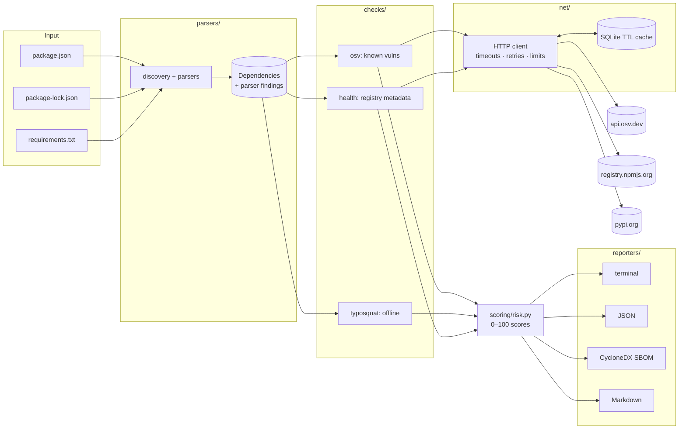

# ChainSentry

**Dependency & supply-chain risk scanner for npm and PyPI projects.**
A CLI and GitHub Action that reads your manifests and lockfiles, then flags
known vulnerabilities, typosquatting look-alikes and unhealthy packages, and
gives every dependency an explainable 0–100 risk score.

```text
┌──────────────────────────────── ChainSentry ────────────────────────────────┐
│ Project risk: 95/100 CRITICAL                                                │
│ Packages: 13 (12 direct)   CRITICAL: 3   HIGH: 3   MEDIUM: 3   LOW: 4        │
│ Known vulnerabilities: 60 in 7 package(s)  (8 critical, 24 high, 23 medium)  │
└──────────────────────────────────────────────────────────────────────────────┘
```

---

## The problem

Modern applications are mostly third-party code. A typical web app pulls in
**hundreds of transitive dependencies**, and attackers know it:

* **Known vulnerabilities** in old versions (Log4Shell, lodash prototype
  pollution) remain the most common way in.
* **Typosquatting**: `crossenv`, `colourama` and `jeIlyfish` were real
  malicious packages that relied on a single typo.
* **Dependency confusion**: in 2021 a researcher ran code inside Apple,
  Microsoft and PayPal by publishing their *internal* package names on
  public registries.
* **Hijacked or abandoned packages**: `event-stream`, `ua-parser-js`, the
  2025 npm "Shai-Hulud" worm. Most of this malware runs through **install
  scripts** the moment you type `npm install`.

`npm audit` and `pip-audit` answer only the first question. ChainSentry
checks all four, in one report, for both ecosystems, and produces an SBOM.

## Features

| | |
|---|---|
| 📦 **Parsers** | `package.json`, `package-lock.json` / `npm-shrinkwrap.json` (lockfile v1, v2, v3), `requirements*.txt` with `-r` includes, hashes, markers and extras |
| 🐞 **Vulnerabilities** | [OSV.dev](https://osv.dev) batch API (GHSA, PYSEC, CVE, MAL), CVSS v3.1 computed from the vector, affected ranges and fixed versions |
| 🔤 **Typosquatting** | Compared against the top 5,000 packages per ecosystem: Damerau-Levenshtein typos, separator tricks, Unicode/visual homoglyphs, combosquats |
| 🩺 **Package health** | Not on the public registry (dependency confusion), install scripts, brand-new packages and versions, abandoned (2+ years), single maintainer, deprecated or yanked, no source repository |
| 🧮 **Risk score** | Simple additive 0–100 score per package and per project, with a per-package breakdown ([docs/SCORING.md](docs/SCORING.md)) |
| 📄 **Outputs** | Coloured terminal report, JSON report, **CycloneDX 1.5 SBOM**, Markdown (PR comments) |
| 🤖 **GitHub Action** | Comments on pull requests, writes a job summary, and fails the check above a configurable threshold |
| 📊 **Dashboard & batch mode** | Static HTML dashboard for reports; scan many public repos and aggregate statistics |
| 🔒 **Safe by design** | Never installs or executes scanned code; bounded file and response sizes; credentials in URLs redacted; offline mode |

## Architecture



Each layer has one job. Parsers never touch the network, checks never print,
scoring is pure math and reporters never compute risk. [`scanner.py`](src/chainsentry/scanner.py)
is the only module that wires them together.

```
src/chainsentry/
├── cli.py              argparse CLI and exit codes
├── scanner.py          orchestrator
├── models.py           shared dataclasses
├── config.py           every threshold and weight
├── registry.py         npm / PyPI metadata summaries
├── resolver.py         --resolve: ranges -> concrete versions
├── net/                HTTP client + SQLite cache
├── parsers/            requirements.txt, package.json, lockfiles, npm semver
├── checks/             osv, cvss, typosquat (+ data/), health
├── scoring/            risk scores and CI policy
└── reporters/          table, json_report, cyclonedx, markdown
```

## Installation

Requires **Python 3.11+**. No Docker needed.

```bash
git clone <this repo> chainsentry
cd chainsentry
python -m venv .venv
.venv\Scripts\activate            # Windows
# source .venv/bin/activate       # Linux / macOS
pip install -e ".[dev]"
chainsentry --version
```

## Usage

```bash
# Scan the current directory (lockfiles and requirements files)
chainsentry scan

# Scan a project, including dev dependencies, writing every report format
chainsentry scan path/to/project --include-dev -f table -f json -f sbom -f markdown -o reports/

# Only list what would be scanned (no network)
chainsentry deps path/to/project --direct-only

# No lockfile? Resolve ranges to the newest matching release so they can be checked
chainsentry scan --resolve

# CI gating: exit 1 if any package is HIGH or worse, or the project scores >= 70
chainsentry scan --fail-on high --min-score 70

# Privacy: never send internal package names to public APIs
chainsentry scan --exclude "@mycorp/*" --exclude "internal-*"

# Air-gapped: parsers + typosquat check only
chainsentry scan --offline
```

| Flag | Meaning |
|---|---|
| `-r, --recursive` | also scan sub-folders (always skips `node_modules`, venvs, `.git`) |
| `--include-dev` | include development-only dependencies |
| `--resolve` | resolve version ranges to the newest matching release |
| `--skip osv\|typosquat\|health` | turn a check off (repeatable) |
| `--exclude GLOB` | leave packages out entirely, so they are never sent to any API |
| `--health-direct-only` | registry health checks for direct dependencies only (faster) |
| `--offline` / `--no-cache` | no network / don't use the local cache |
| `-f, --format` | `table`, `json`, `sbom`, `markdown` (repeatable) |
| `-o, --output-dir` | where report files go (default `chainsentry-report/`) |
| `--fail-on` | `none`, `low`, `medium`, `high`, `critical` (default) |
| `--min-score N` | also fail when the project score is ≥ N |
| `--details` | print every vulnerability and finding message |

**Exit codes:** `0` passed · `1` risk threshold exceeded · `2` usage or parse error.

API responses are cached for 6–24 hours (`chainsentry cache path` shows
where; `chainsentry cache clear` empties it).

## Sample output

Scanning the deliberately vulnerable [demo project](tests/fixtures/demo) (excerpt):

```text
Packages at risk
┌───────┬─────────────────┬─────────┬─────────────┬───────────────┬──────────────────────────────────┐
│ Score │ Package         │ Version │ Type        │         Vulns │ Issues                           │
├───────┼─────────────────┼─────────┼─────────────┼───────────────┼──────────────────────────────────┤
│    85 │ django          │ 3.2.0   │ direct      │ 6C 15H 12M 5L │                                  │
│    85 │ minimist        │ 1.2.5   │ direct, dev │            1C │ ABANDONED                        │
│    75 │ pyyaml          │ 5.3.1   │ direct      │            1C │                                  │
│    70 │ colourama       │ 0.1.6   │ direct      │             - │ TYPOSQUAT, NOT_IN_REGISTRY       │
│    65 │ lodash          │ 4.17.15 │ direct      │         3H 3M │ SINGLE_MAINTAINER                │
│    60 │ urllib3         │ 1.26.4  │ direct      │         6H 5M │                                  │
│    27 │ express         │ 4.17.1  │ direct      │            2M │                                  │
│    25 │ left-pad        │ 1.3.0   │ direct      │             - │ NPM_ALIAS, ABANDONED, DEPRECATED │
│    10 │ internal-lib    │ 1.0.0   │ direct      │             - │ NON_REGISTRY_SOURCE              │
│     5 │ requests        │ >=2.20  │ direct      │             - │ UNPINNED                         │
└───────┴─────────────────┴─────────┴─────────────┴───────────────┴──────────────────────────────────┘
FAIL: 3 package(s) rated CRITICAL or worse: minimist@1.2.5, django@3.2.0, pyyaml@5.3.1
```

Full outputs: [terminal](docs/sample-output/terminal.txt) ·
[JSON report](docs/sample-output/report.json) ·
[CycloneDX SBOM](docs/sample-output/sbom.cdx.json) ·
[PR comment](docs/sample-output/report.md)

## GitHub Action

ChainSentry is a **composite action** (no Docker). Add
`.github/workflows/chainsentry.yml` to a repository:

```yaml
name: Dependency risk
on: pull_request
permissions:
  contents: read
  pull-requests: write      # to post the PR comment
jobs:
  chainsentry:
    runs-on: ubuntu-latest
    steps:
      - uses: actions/checkout@<sha>        # pin actions to a commit SHA
      - uses: <owner>/chainsentry@<sha>
        with:
          path: .
          fail-on: critical                 # none | low | medium | high | critical
          include-dev: "false"
          comment: "true"
```

On every pull request it posts (and later *updates*) one comment with the
Markdown report, writes the job summary, uploads the JSON report and SBOM as
artifacts, and fails the check when the threshold is exceeded. See
[action.yml](action.yml) for all inputs and outputs.

## Dashboard

[`dashboard/index.html`](dashboard/index.html) is a single static page with
no dependencies and no build step. Open it in a browser and drop a
`report.json` onto it. The file is read locally and never uploaded.

```bash
python -m http.server 8000        # then open http://localhost:8000/dashboard/ and click "Load sample"
```

It shows the project score ring, severity breakdown, and a sortable,
filterable package table. Each row expands to show its score breakdown,
vulnerabilities (linked to OSV) and findings. All report text is rendered as
text, never HTML, and a Content-Security-Policy blocks any outbound requests.

## Batch mode (aggregate statistics)

Scan many public GitHub repositories (root manifests only, no cloning) and
aggregate the results:

```bash
set GITHUB_TOKEN=<token>          # Windows; export GITHUB_TOKEN=... elsewhere (raises the limit from 60 to 5,000 req/h)
python scripts/batch_scan.py --search "language:javascript stars:>5000" --limit 100 --skip-health
python scripts/batch_scan.py --repos scripts/repos-sample.txt --include-dev
```

Results go to `batch-results/`: one JSON report per repository, plus
`stats.json`, `stats.csv` and `SUMMARY.md` (repositories scanned, dependencies
analysed, % of repos with known/critical vulnerabilities, most common
vulnerable packages and advisories). An interrupted run resumes where it
stopped. When you quote these numbers, also state the sample (how the repos
were chosen) and the "not checked" count, which covers dependencies without
an exact version.

## Testing

```bash
pytest                                  # unit tests, network fully mocked
pytest --cov=chainsentry                # with coverage
pytest -m network                       # opt-in live API tests
ruff check .                            # lint
```

## Limitations

* **Lockfiles are needed for precise results.** With only `package.json` or
  ranged requirements, the installed version is unknown. `--resolve` shows
  "what would be installed today", not what is deployed.
* **requirements.txt has no transitive dependencies.** Scan the output of
  `pip freeze` or `pip-compile` for full coverage. Poetry, Pipenv, uv and
  pnpm/yarn lockfiles are not supported yet.
* **Environment markers are not evaluated**, so every dependency that could
  apply is reported.
* **CVSS base score ≠ real risk.** Reachability analysis, EPSS and CISA KEV
  are not used yet. CVSS v4-only advisories fall back to the advisory's
  label.
* **Typosquatting is heuristic**, with both false positives (use the
  allowlist) and false negatives (novel tricks, names outside the top
  5,000).
* **Health signals are heuristics.** PyPI's JSON API does not expose
  maintainers, and private registry mirrors appear as "non-registry
  sources".
* The score weights are expert judgement, not a trained model
  ([docs/SCORING.md](docs/SCORING.md)).

## Learn more

* [docs/SCORING.md](docs/SCORING.md): the scoring formula with worked examples
* [docs/SECURITY_CONCEPTS.md](docs/SECURITY_CONCEPTS.md): CVE vs GHSA, CVSS,
  SBOMs, dependency confusion, typosquatting and real incidents
* [PLAN.md](PLAN.md): the phase-by-phase design plan

## License

MIT © 2026 Yashasvi Dagar
